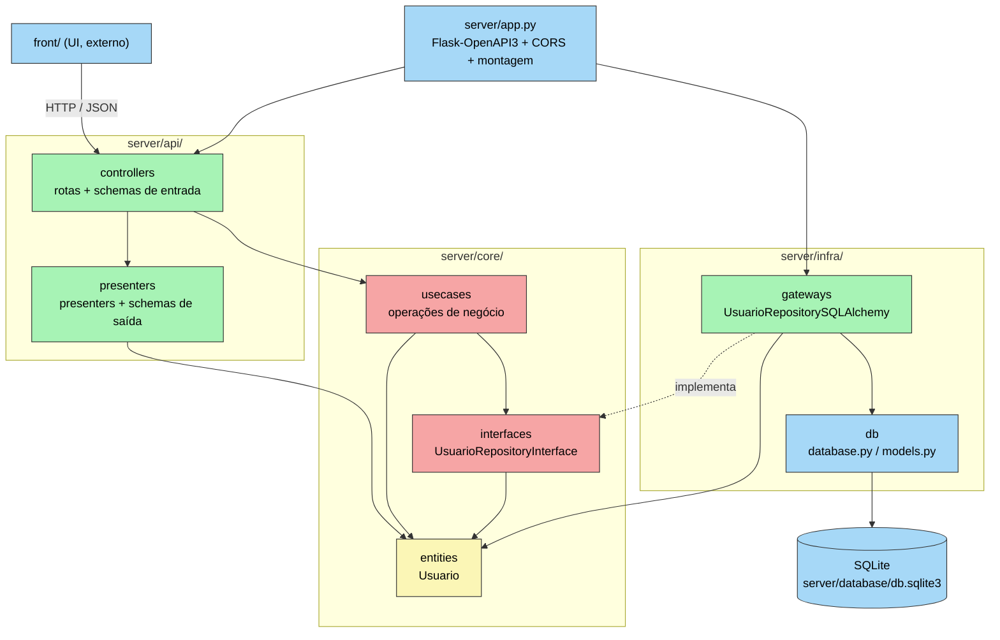
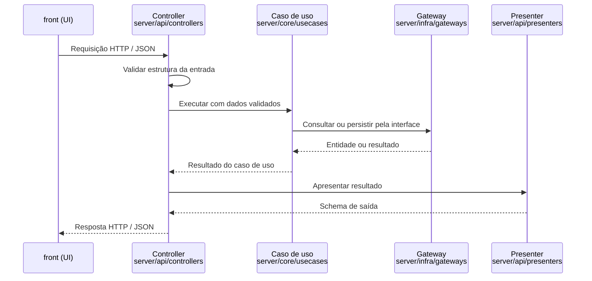

# Clean Architecture na API de Classificados

Este documento adapta a arquitetura de [ARQUITETURA.md](ARQUITETURA.md) ao
domínio de classificados universitários. A API fica em `server/`; o projeto de
interface `front/` é externo a este repositório.

## Estrutura de pastas

```text
server/
├── app.py                              # cria a API, configura CORS e monta dependências
├── requirements.txt                   # dependências da API e ferramentas Python
├── core/                               # regras de negócio sem Flask ou SQLAlchemy
│   ├── entities/
│   │   └── usuario.py                 # Usuario como entidade Python pura
│   ├── interfaces/
│   │   └── usuario_repository_interface.py  # contrato de persistência de Usuario
│   └── usecases/
│       ├── erros.py                   # erros de aplicação sem códigos HTTP
│       └── __init__.py
├── infra/                              # adaptadores técnicos
│   ├── db/
│   │   ├── database.py                # engine, Session e criação das tabelas
│   │   ├── models.py                  # UsuarioModel do SQLAlchemy
│   │   ├── schema.sql                 # schema SQLite de referência
│   │   └── README.md                  # documentação do modelo persistido
│   └── gateways/
│       └── usuario_repository_sqlalchemy.py  # gateway SQLAlchemy
└── api/                                # entrada e saída HTTP
    ├── controllers/
    │   └── health_controller.py       # controller HTTP de saúde da API
    └── presenters/
        ├── error_presenter.py          # ErrorSchema e apresentação de erros
        └── health_presenter.py        # schema e apresentação da resposta de saúde

tests/                                  # testes organizados pelos adaptadores/camadas
├── api/
├── core/
│   ├── entities/
│   └── usecases/
└── infra/
    ├── db/
    └── gateways/

spec/                                   # especificações, planos e tarefas SDD
.github/skills/                         # skills do projeto
Makefile                                # instalação, lint e testes
README.md                               # guia principal
setup.cfg                               # configuração de pytest e Flake8
```

O controller de saúde preserva o endpoint existente `GET /health`. Os casos
de uso de autenticação, perfil e anúncios devem ser acrescentados a `core/`
quando suas especificações e decisões pendentes estiverem definidas.

### Correspondência com o diagrama

| Camada do diagrama | Diretório |
|---|---|
| Entities | `server/core/entities/` |
| Use Cases | `server/core/usecases/` + `server/core/interfaces/` |
| Controllers, Presenters | `server/api/controllers/`, `server/api/presenters/` |
| Gateways | `server/infra/gateways/` |
| DB | `server/infra/db/` (SQLAlchemy + SQLite) |
| Web | Flask-OpenAPI3 e CORS, configurados em `server/app.py` |
| UI | `front/` (fora da API e não incluído neste repositório) |
| Devices, External Interfaces | não há integração implementada atualmente |

## Diagrama de dependências

As setas indicam **quem importa quem**. As dependências de negócio apontam
para dentro, em direção ao `core`; o `core` não importa `api/` nem `infra/`.
`server/app.py` é o único ponto de montagem que conhece os adaptadores
concretos.



`server/app.py` cria o repositório concreto e o disponibiliza para a camada
de casos de uso quando eles forem montados. A interface define o contrato sem
saber que a implementação usa SQLAlchemy.

## Fluxo de uma requisição

O fluxo abaixo é genérico: não define uma rota de negócio que ainda não esteja
especificada.



Se uma regra de negócio falhar, o caso de uso produz um erro independente de
HTTP e o controller/presenter o converte em resposta. Assim, o `core` não
conhece códigos de status.

## Schemas: entrada com o controller, saída com o presenter

Os schemas Pydantic descrevem a forma dos dados, sem substituir regras de
negócio:

- **Schemas de entrada** ficam em `api/controllers/`, junto ao controller que
  os valida antes de chamar o caso de uso.
- **Entidades**, como `Usuario`, pertencem a `core/entities/`; não são modelos
  SQLAlchemy nem respostas HTTP.
- **Schemas de saída** ficam em `api/presenters/`. O presenter cria o modelo
  de resposta a partir da entidade ou do resultado do caso de uso.
- **`ErrorSchema`** fica no presenter de erros. O controller converte erros
  conhecidos em respostas HTTP; casos de uso não importam schemas HTTP.
- Campos pessoais só podem aparecer em respostas conforme a regra de
  visibilidade aprovada para o perfil.

## Regras de domínio: autenticação e perfil

A épica [PROJ-8](https://matheuscomputacaopuc.atlassian.net/browse/PROJ-8)
é detalhada pelas histórias
[PROJ-1 — Logar com validação institucional](https://matheuscomputacaopuc.atlassian.net/browse/PROJ-1)
e
[PROJ-4 — Completar perfil de anunciante](https://matheuscomputacaopuc.atlassian.net/browse/PROJ-4).
Estas regras pertencem ao `core`; controllers e banco não devem ser a única
camada que as aplica.

### Autenticação institucional

- O público elegível é composto por alunos e funcionários; terceirizados estão
  fora do escopo atual. Uma conta nova só pode ser criada para pessoa com um
  desses vínculos.
- O fluxo pretendido usa matrícula e senha. Essa escolha depende do resultado
  do EN01; se matrícula não for viável, o plano B é usar e-mail institucional.
  A decisão precisa ser confirmada antes de fixar o mecanismo de login.
- Credenciais inválidas devem produzir a mensagem
  `Matrícula ou senha inválidas`. Após cinco tentativas erradas consecutivas,
  o login fica bloqueado por dez minutos.
- Senhas devem ser armazenadas com hash seguro, nunca em texto puro nem por
  criptografia reversível.

### Perfil de anunciante

- O perfil inclui nome de exibição, foto opcional, WhatsApp e e-mail de contato.
- O vínculo de aluno ou funcionário vem do cadastro, aparece no perfil e não
  pode ser editado pelo fluxo de perfil.
- O perfil está completo quando tem nome de exibição e pelo menos uma forma de
  contato (WhatsApp ou e-mail). A publicação exige perfil completo; a regra
  pertence ao caso de uso de publicação.
- Foto acima de 2 MB ou em formato não aceito deve ser rejeitada sem salvar
  essa foto; ela pode ser omitida. Os formatos aceitos ainda precisam ser
  definidos.
- A visibilidade do perfil para compradores ainda consta como pendência na
  Definition of Ready de PROJ-4. Até essa decisão, não presuma que e-mail,
  WhatsApp, matrícula ou outros dados sejam públicos.

## Persistência e testes

O modelo SQLite atual contém `Usuario` com `id`, `nome`, `email`, `matricula`
e `vinculo`, documentado em `server/infra/db/README.md`. `UsuarioModel` no
SQLAlchemy mantém as mesmas colunas e constraints do `schema.sql`.
`create_all` cria tabelas ausentes, mas não atualiza tabelas já existentes;
mudanças incompatíveis exigem migração explícita.

- Testes de entidades ficam em `tests/core/entities/`.
- Testes de casos de uso ficam em `tests/core/usecases/` e usam repositórios
  falsos em memória.
- Testes dos gateways e do schema ficam em `tests/infra/`.
- Testes dos controllers e presenters ficam em `tests/api/`.
- Toda mudança persistida sincroniza modelos SQLAlchemy, `schema.sql`,
  documentação e testes.
