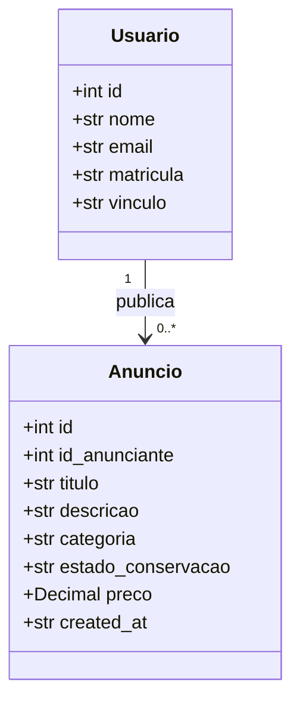

# Modelagem do banco de dados

O projeto usa SQLite. O schema base fica em [schema.sql](schema.sql) e as
migrations incrementais ficam em `migrations/`. A função `initialize_database`
aplica o schema e as migrations uma vez por versão, usando `PRAGMA user_version`.
Toda conexão da aplicação deve ser aberta por `connect_database` em
[database.py](database.py), que habilita e verifica `PRAGMA foreign_keys`.

## Diagrama UML

`id` é a chave primária técnica, gerada pelo banco. `email` e `matricula` são
identificadores únicos de negócio, mas não são usados como chave primária.

Manter uma chave substituta (`id`) evita que referências internas dependam de
identificadores institucionais ou dados de contato, que podem mudar ou exigir
maior cuidado de privacidade. A matrícula permanece obrigatória e única.

## Tabela `usuarios`

| Coluna | Tipo | Obrigatória | Restrições | Descrição |
|---|---|---:|---|---|
| `id` | INTEGER | Sim | Chave primária, autoincremento | Identificador interno do usuário |
| `nome` | TEXT | Sim | Não pode ser vazio ou conter somente espaços ASCII | Nome do usuário |
| `email` | TEXT | Sim | Único no valor armazenado; não pode ser vazio ou conter somente espaços ASCII | E-mail do usuário |
| `matricula` | TEXT | Sim | Única no valor armazenado; não pode ser vazia ou conter somente espaços ASCII | Matrícula institucional |
| `vinculo` | TEXT | Sim | Não pode ser vazio ou conter somente espaços ASCII | Vínculo institucional, como aluno ou funcionário |

O banco garante as constraints estruturais acima, mas não valida o formato ou
domínio do e-mail, nem normaliza caixa ou espaços nas extremidades. Essas
validações devem ser feitas no backend antes da persistência. A unicidade do
banco compara os valores armazenados segundo a collation padrão do SQLite.

Anunciante não é uma entidade separada. É o papel de um usuário que publica
anúncios.

## Tabela `anuncios`

| Coluna | Tipo | Obrigatória | Restrições | Descrição |
|---|---|---:|---|---|
| `id` | INTEGER | Sim | Chave primária, autoincremento | Identificador do anúncio |
| `id_anunciante` | INTEGER | Sim | FK para `usuarios(id)`, `ON DELETE CASCADE` | Usuário que publicou o anúncio |
| `titulo` | TEXT | Sim | 5–80 caracteres; sem espaços ASCII nas extremidades | Título do anúncio |
| `categoria` | TEXT | Sim | `produto`, `servico` ou `evento` | Tipo do anúncio |
| `estado_conservacao` | TEXT | Não | `NULL`, `novo` ou `usado_regular` | Estado do produto, validado conforme categoria no back-end |
| `descricao` | TEXT | Sim | Não vazia ou só espaços; até 500 caracteres | Descrição do anúncio |
| `preco` | NUMERIC(12,2) | Não | `NULL` ou de 0 a 9999999999.99; até duas casas decimais | Preço em reais; `NULL` significa “a combinar”, zero é permitido |
| `created_at` | TEXT | Sim | UTC ISO-8601, definido pelo `DEFAULT` do banco | Momento de criação |

SQLite não oferece UUID nem TIMESTAMPTZ. O projeto usa IDs inteiros
autoincrementais e guarda `created_at` como texto UTC ISO-8601. O preço tem
faixa, escala e tipo de armazenamento verificados por `CHECK`; `NULL` indica
“a combinar”, sem uma coluna adicional, e o modelo Python usa `Decimal | None`,
nunca `float`. O sistema usa reais como moeda única, sem armazenar uma coluna
de moeda. Como SQLite desabilita FKs por padrão, cada conexão da aplicação
deve ser aberta por `connect_database`, que liga e confirma
`PRAGMA foreign_keys` como `ON`. O cascade evita anúncios órfãos quando o
usuário que os publicou é removido.

`categoria` é limitada por `CHECK` a `produto`, `servico` e `evento`; rótulos
com acentos são responsabilidade da interface. Se as categorias passarem a
ser dinâmicas ou precisarem de metadados, uma tabela própria pode substituir
essa restrição. `estado_conservacao` aceita `NULL`, `novo` ou `usado_regular`;
a obrigatoriedade para anúncios de produto é uma regra do back-end. O nome de
quem publicou é obtido por `JOIN` com `usuarios.nome`, sem duplicá-lo na tabela.

Os índices cobrem anunciante, categoria, data decrescente e categoria com data
decrescente. Não foi adicionado full-text search. Os dados de exemplo ficam
em `seeds/anuncios.sql` e não são executados automaticamente na inicialização.

Campos como `status`, `updated_at` e `deleted_at` podem ser avaliados depois,
mas não fazem parte do modelo atual.

O `schema.sql` é usado para criar tabelas que ainda não existem. Alterações
incompatíveis com bancos já inicializados precisam de uma migração explícita;
editar o schema de criação não modifica tabelas existentes.

## Evolução do modelo

Ao adicionar, alterar ou remover dados persistidos, atualize em conjunto:

1. `schema.sql` e a inicialização/migração necessária;
2. este documento e o diagrama;
3. testes de constraints e comportamento de persistência;
4. o README principal, caso o local ou fluxo documentado do banco mude.

Antes de remover ou tornar obrigatório um campo, avalie os dados já existentes
e defina como serão migrados. Não descarte nem transforme dados existentes sem
uma regra aprovada.
