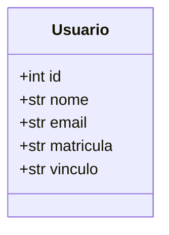

# Modelagem do banco de dados

O projeto usa SQLite. O schema de referência fica em [schema.sql](schema.sql)
e é aplicado pela função `initialize_database` em [database.py](database.py).

## Diagrama UML

`id` é a chave primária técnica, gerada pelo banco. `email` e `matricula` são
identificadores únicos de negócio, mas não são usados como chave primária.

Manter uma chave substituta (`id`) evita que referências internas dependam de
identificadores institucionais ou dados de contato, que podem mudar ou exigir
maior cuidado de privacidade. A matrícula permanece obrigatória e única.

## Tabela `usuarios`

| Coluna | Tipo | Obrigatória | Restrições | Descrição |
|---|---|---:|---|---|
| `id` | INTEGER | Sim | Chave primária, autoincremento | Identificador interno do usuário |
| `nome` | TEXT | Sim | Não pode ser vazio ou conter somente espaços ASCII | Nome do usuário |
| `email` | TEXT | Sim | Único no valor armazenado; não pode ser vazio ou conter somente espaços ASCII | E-mail do usuário |
| `matricula` | TEXT | Sim | Única no valor armazenado; não pode ser vazia ou conter somente espaços ASCII | Matrícula institucional |
| `vinculo` | TEXT | Sim | Não pode ser vazio ou conter somente espaços ASCII | Vínculo institucional, como aluno ou funcionário |

O banco garante as constraints estruturais acima, mas não valida o formato ou
domínio do e-mail, nem normaliza caixa ou espaços nas extremidades. Essas
validações devem ser feitas no backend antes da persistência. A unicidade do
banco compara os valores armazenados segundo a collation padrão do SQLite.

O `schema.sql` é usado para criar tabelas que ainda não existem. Alterações
incompatíveis com bancos já inicializados precisam de uma migração explícita;
editar o schema de criação não modifica tabelas existentes.

## Evolução do modelo

Ao adicionar, alterar ou remover dados persistidos, atualize em conjunto:

1. `schema.sql` e a inicialização/migração necessária;
2. este documento e o diagrama;
3. testes de constraints e comportamento de persistência;
4. o README principal, caso o local ou fluxo documentado do banco mude.

Antes de remover ou tornar obrigatório um campo, avalie os dados já existentes
e defina como serão migrados. Não descarte nem transforme dados existentes sem
uma regra aprovada.
