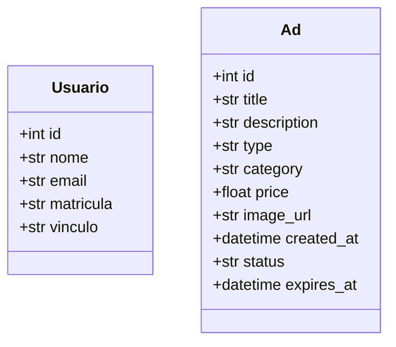

# Modelagem do banco de dados

O projeto usa SQLAlchemy sobre SQLite. O modelo ORM fica em
[models.py](models.py); a função `initialize_database` em
[database.py](database.py) cria as tabelas declaradas pelo metadata. O arquivo
[schema.sql](schema.sql) documenta o mesmo schema e deve permanecer sincronizado
com o modelo.

## Diagrama UML

`id` é a chave primária técnica, gerada pelo banco. `email` e `matricula` são
identificadores únicos de negócio, mas não são usados como chave primária.

Manter uma chave substituta (`id`) evita que referências internas dependam de
identificadores institucionais ou dados de contato, que podem mudar ou exigir
maior cuidado de privacidade. A matrícula permanece obrigatória e única.

## Tabela `usuarios`

| Coluna | Tipo | Obrigatória | Restrições | Descrição |
|---|---|---:|---|---|
| `id` | INTEGER | Sim | Chave primária, autoincremento | Identificador interno do usuário |
| `nome` | TEXT | Sim | Não pode ser vazio ou conter somente espaços ASCII | Nome do usuário |
| `email` | TEXT | Sim | Único no valor armazenado; não pode ser vazio ou conter somente espaços ASCII | E-mail do usuário |
| `matricula` | TEXT | Sim | Única no valor armazenado; não pode ser vazia ou conter somente espaços ASCII | Matrícula institucional |
| `vinculo` | TEXT | Sim | Não pode ser vazio ou conter somente espaços ASCII | Vínculo institucional, como aluno ou funcionário |

## Tabela `ads`

| Coluna | Tipo | Obrigatória | Restrições | Descrição |
|---|---|---:|---|---|
| `id` | INTEGER | Sim | Chave primária, autoincremento | Identificador interno do anúncio |
| `title` | TEXT | Sim | Não pode ser vazio ou conter somente espaços ASCII | Título do anúncio |
| `description` | TEXT | Não | — | Descrição opcional do anúncio |
| `type` | TEXT | Sim | `product` ou `service` | Tipo do anúncio |
| `category` | TEXT | Sim | Não pode ser vazia ou conter somente espaços ASCII | Categoria do anúncio |
| `price` | REAL | Sim | Valor numérico | Preço do anúncio |
| `image_url` | TEXT | Não | Pode ser nulo | URL da foto do anúncio |
| `created_at` | DATETIME | Sim | Data de criação | Momento de criação do anúncio |
| `status` | TEXT | Sim | `published`, `sold` ou `expired` | Estado de disponibilidade |
| `expires_at` | DATETIME | Não | Pode ser nulo | Momento de expiração, quando aplicável |

Os anúncios sem foto usam `image_url` nulo. O feed considera disponíveis apenas
os anúncios publicados; anúncios vendidos ou expirados não devem ser retornados.
O banco não calcula a expiração automática: essa regra pertence ao domínio e ao
caso de uso de publicação.

O banco garante as constraints estruturais acima, mas não valida o formato ou
domínio do e-mail, nem normaliza caixa ou espaços nas extremidades. A entidade
`Usuario` valida o formato do endereço e aceita somente os domínios
`@aluno.puc-rio.br` e `@puc-rio.br` antes da persistência. A unicidade do banco
compara os valores armazenados segundo a collation padrão do SQLite.

O banco padrão fica em `server/database/db.sqlite3`; testes devem usar um banco
SQLite em memória. `create_all` cria tabelas ausentes, mas não atualiza tabelas
existentes. Alterações incompatíveis precisam de uma migração explícita; editar
o modelo ou o `schema.sql` não modifica bancos já inicializados.

## Evolução do modelo

Ao adicionar, alterar ou remover dados persistidos, atualize em conjunto:

1. `schema.sql` e a inicialização/migração necessária;
2. este documento e o diagrama;
3. testes de constraints e comportamento de persistência;
4. o README principal, caso o local ou fluxo documentado do banco mude.

Antes de remover ou tornar obrigatório um campo, avalie os dados já existentes
e defina como serão migrados. Não descarte nem transforme dados existentes sem
uma regra aprovada.
