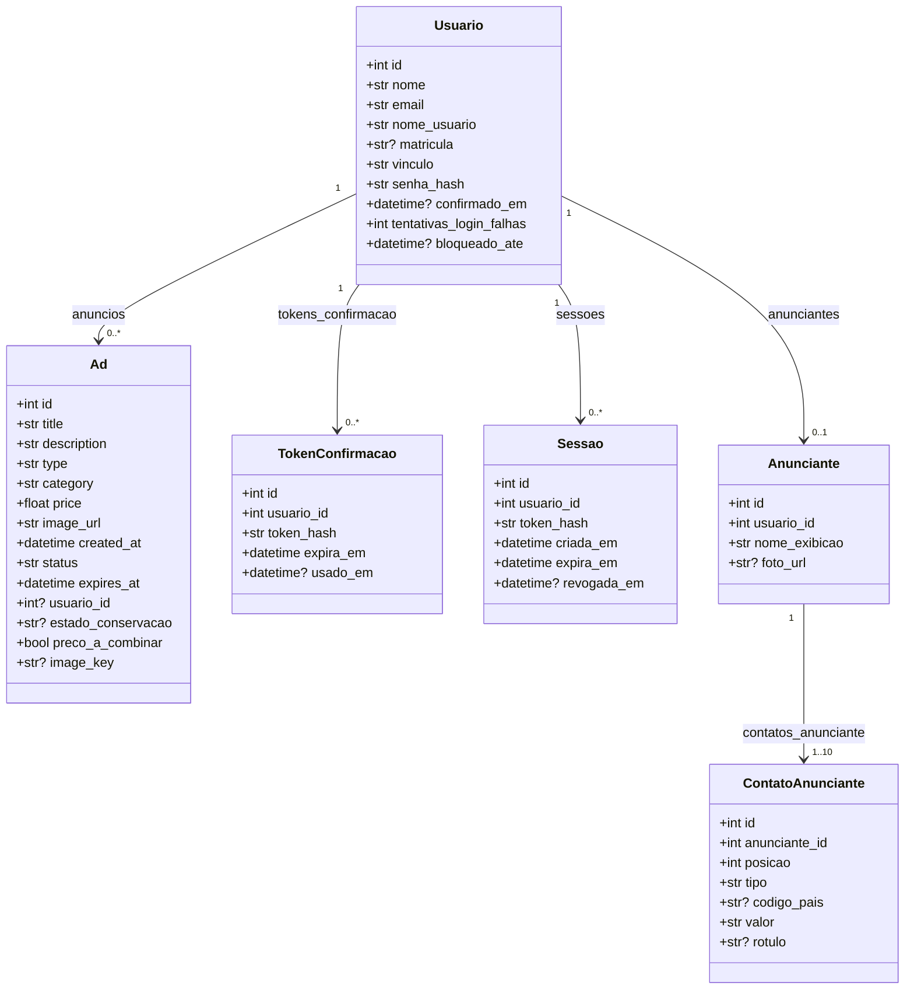

# Modelagem do banco de dados

O projeto usa SQLAlchemy sobre SQLite. Os modelos ORM ficam em
[models.py](models.py); a função `initialize_database` em
[database.py](database.py) cria as tabelas declaradas pelo metadata. O arquivo
[schema.sql](schema.sql) documenta o mesmo schema e deve permanecer sincronizado
com os modelos.

## Diagrama UML

`id` é a chave primária técnica, gerada pelo banco. `email` é o identificador
principal de negócio da conta (único e obrigatório); `nome_usuario` e
`matricula` são identificadores alternativos, também únicos. Nenhum deles é
usado como chave primária.

Manter uma chave substituta (`id`) evita que referências internas dependam de
identificadores institucionais ou dados de contato, que podem mudar ou exigir
maior cuidado de privacidade. A matrícula é opcional e única quando informada.

## Tabela `usuarios`

| Coluna | Tipo | Obrigatória | Restrições | Descrição |
|---|---|---:|---|---|
| `id` | INTEGER | Sim | Chave primária, autoincremento | Identificador interno do usuário |
| `nome` | TEXT | Sim | Não pode ser vazio ou conter somente espaços ASCII | Nome do usuário |
| `email` | TEXT | Sim | Único; não pode ser vazio ou conter somente espaços ASCII | E-mail institucional, identificador principal |
| `nome_usuario` | TEXT | Sim | Único; não vazio; não pode conter `@` | Identificador alternativo de login |
| `matricula` | TEXT | Não | Única quando preenchida (vários `NULL` são aceitos); não vazia se informada | Matrícula informada pela pessoa, sem conferência |
| `vinculo` | TEXT | Sim | `aluno` ou `funcionario` | Vínculo institucional |
| `senha_hash` | TEXT | Sim | Não vazio | Hash da senha (werkzeug); a senha nunca é gravada |
| `confirmado_em` | DATETIME | Não | — | Momento da confirmação do e-mail; `NULL` = pendente |
| `tentativas_login_falhas` | INTEGER | Sim | Padrão `0`; `>= 0` | Falhas de senha seguidas desde o último login ou bloqueio |
| `bloqueado_ate` | DATETIME | Não | — | Fim do bloqueio de login, se houver |

## Tabela `tokens_confirmacao`

| Coluna | Tipo | Obrigatória | Restrições | Descrição |
|---|---|---:|---|---|
| `id` | INTEGER | Sim | Chave primária, autoincremento | Identificador interno |
| `usuario_id` | INTEGER | Sim | FK → `usuarios.id`, `ON DELETE CASCADE`; indexada | Dono do link |
| `token_hash` | TEXT | Sim | Único | SHA-256 do token enviado por e-mail |
| `expira_em` | DATETIME | Sim | — | Fim da validade (15 minutos após a emissão) |
| `usado_em` | DATETIME | Não | — | Uso ou invalidação do link; `NULL` = ainda não usado |

## Tabela `sessoes`

| Coluna | Tipo | Obrigatória | Restrições | Descrição |
|---|---|---:|---|---|
| `id` | INTEGER | Sim | Chave primária, autoincremento | Identificador interno |
| `usuario_id` | INTEGER | Sim | FK → `usuarios.id`, `ON DELETE CASCADE`; indexada | Dono da sessão |
| `token_hash` | TEXT | Sim | Único | SHA-256 do token de sessão (`Authorization: Bearer`) |
| `criada_em` | DATETIME | Sim | — | Momento do login |
| `expira_em` | DATETIME | Sim | — | Fim da validade (`SESSAO_DURACAO_HORAS`) |
| `revogada_em` | DATETIME | Não | — | Logout; `NULL` = não revogada |

## Tabela `anunciantes`

Perfil de anunciante: extensão **opcional** do perfil comum (`usuarios`), com
no máximo um por usuário. Não há coluna "completo": ter uma linha aqui é ser
anunciante. Os contatos ficam na tabela filha `contatos_anunciante`. Decisões
D-010 e D-013 de `spec/decisoes.md`.

| Coluna | Tipo | Obrigatória | Restrições | Descrição |
|---|---|---:|---|---|
| `id` | INTEGER | Sim | Chave primária, autoincremento | Identificador interno |
| `usuario_id` | INTEGER | Sim | Único; FK → `usuarios.id`, `ON DELETE CASCADE` | Dono do perfil (relação 1:1 opcional) |
| `nome_exibicao` | TEXT | Sim | Não vazio | Nome mostrado aos compradores |
| `foto_url` | TEXT | Não | Não vazio se informado | Caminho da foto (`/fotos-perfil/<arquivo>`) |

## Tabela `contatos_anunciante`

Uma linha por contato do anunciante: WhatsApp, telefone, e-mail, site ou link.
Pode haver vários do mesmo tipo.

| Coluna | Tipo | Obrigatória | Restrições | Descrição |
|---|---|---:|---|---|
| `id` | INTEGER | Sim | Chave primária, autoincremento | Identificador interno |
| `anunciante_id` | INTEGER | Sim | FK → `anunciantes.id`, `ON DELETE CASCADE` | Dono do contato |
| `posicao` | INTEGER | Sim | `>= 0`; único por anunciante | Ordem escolhida pela pessoa (0 é o primeiro) |
| `tipo` | TEXT | Sim | `whatsapp`, `telefone`, `email`, `site` ou `link` | Tipo do contato |
| `codigo_pais` | TEXT | Não | Obrigatório em `telefone`, opcional em `whatsapp`, proibido nos demais; só dígitos, 1 a 3 | Código do país (ex.: `55`). Em `whatsapp`, vazio significa "informado por link" |
| `valor` | TEXT | Sim | Não vazio; veja as regras por tipo abaixo | Número, e-mail ou endereço |
| `rotulo` | TEXT | Não | Só em `link`; não vazio se informado | Nome mostrado junto do link (ex.: "Instagram") |

Regras de `valor` por tipo:

| Tipo | `codigo_pais` | `valor` |
|---|---|---|
| `whatsapp` por número | preenchido | Só dígitos; código + número somam de 8 a 15 dígitos |
| `whatsapp` por link | vazio | Começa com `https://wa.me/` ou `https://api.whatsapp.com/`, com algo depois e sem espaços |
| `telefone` | preenchido | Só dígitos; código + número somam de 8 a 15 dígitos |
| `email` | vazio | Contém `@` depois do primeiro caractere |
| `site` e `link` | vazio | Começa com `https://` e não tem espaços |

O código do país fica separado do número para que a tela o mostre selecionado
ao editar (os códigos têm de 1 a 3 dígitos, então não dá para separá-los
depois de juntos).

Mapeamento com os nomes da subtarefa PROJ-25 do Jira (decisão D-041):
`id_usuario` → `anunciantes.usuario_id`, `nome` → `anunciantes.nome_exibicao`,
`foto_url` sem mudança, e `whatsapp` e `email_contato` viram linhas de
`contatos_anunciante` (a decisão de contatos como lista é de 2026-11-20).

## Regras fora do banco

## Tabela `ads`

| Coluna | Tipo | Obrigatória | Restrições | Descrição |
|---|---|---:|---|---|
| `id` | INTEGER | Sim | Chave primária, autoincremento | Identificador interno do anúncio |
| `title` | TEXT | Sim | Não pode ser vazio ou conter somente espaços ASCII | Título do anúncio |
| `description` | TEXT | Não | — | Descrição opcional do anúncio |
| `type` | TEXT | Sim | `product`, `service` ou `event` | Tipo do anúncio |
| `category` | TEXT | Sim | Não pode ser vazia ou conter somente espaços ASCII | Categoria do anúncio |
| `price` | REAL | Sim | Valor numérico | Preço do anúncio |
| `image_url` | TEXT | Não | Pode ser nulo | URL da foto do anúncio |
| `created_at` | DATETIME | Sim | Data de criação | Momento de criação do anúncio |
| `status` | TEXT | Sim | `published`, `sold` ou `expired` | Estado de disponibilidade |
| `expires_at` | DATETIME | Não | Nulo permitido para anúncios legados; publicações novas recebem prazo | Momento de expiração |
| `usuario_id` | INTEGER | Não | FK → `usuarios.id`, `ON DELETE CASCADE`; nulo apenas para anúncios anteriores à integração | Usuário que publicou |
| `estado_conservacao` | TEXT | Não | `novo` ou `usado_regular`; nulo para serviço/evento e anúncios antigos | Conservação do produto |
| `preco_a_combinar` | BOOLEAN | Sim | `0` ou `1`; padrão `0` | Indica preço negociável |
| `image_key` | TEXT | Não | Pode ser nulo | Chave da imagem no storage local/S3 |

`image_url` preserva URLs existentes; novas imagens usam `image_key`, e a URL
é resolvida pelo adaptador de storage. Sem foto, ambos ficam nulos. O feed
considera disponíveis apenas os anúncios publicados; anúncios vendidos ou
expirados não devem ser retornados. Publicações novas recebem expiração em
30 dias, calculada pelo caso de uso; o feed também oculta anúncios publicados
cujo prazo já passou. O banco não atualiza automaticamente o estado do anúncio.

O banco garante as constraints estruturais acima, mas não valida o formato ou
o domínio do e-mail. A entidade `Usuario` valida o endereço (apenas
`@aluno.puc-rio.br` e `@puc-rio.br`) e grava `email`, `nome_usuario` e
`matricula` normalizados (sem espaços nas pontas e em minúsculas). Por isso
os `UNIQUE` simples bastam para a unicidade sem diferenciar maiúsculas de
minúsculas.

O banco **não** garante, em `contatos_anunciante`: o mínimo de 1 e o máximo de
10 contatos por anunciante, a ausência de contatos repetidos (mesmo tipo, código
do país e valor) e o formato completo do e-mail. Essas regras ficam nas
entidades `Anunciante` e `Contato`, que também fazem a limpeza das máscaras de
telefone (remover `+`, espaços, parênteses e hífens). O gateway grava o
anunciante e a lista inteira de contatos numa única transação: se algo falhar,
nada muda.

Os `CHECK` de `contatos_anunciante` repetem de propósito as regras de dígitos e
de endereço (`https://` e hosts do WhatsApp), para que nenhum caminho de escrita
grave um endereço de outro tipo (como `javascript:` ou `http://`) que depois
seria mostrado aos compradores.

A regra de que nenhum valor pode ser, ao mesmo tempo, o nome de usuário de
uma conta e a matrícula de outra é conferida pelo caso de uso
`CadastrarUsuario`: o SQLite não oferece constraint entre colunas diferentes.

Datas são gravadas em UTC, sem fuso, e lidas de volta como `datetime` com fuso
UTC pelo tipo `UTCDateTime` de `models.py`.

O SQLite só aplica chaves estrangeiras e `ON DELETE CASCADE` com
`PRAGMA foreign_keys=ON`; `create_database_engine` ativa esse pragma em cada
conexão.

## Banco local e migração

O banco padrão fica em `server/database/db.sqlite3`; testes devem usar um banco
SQLite em memória. `create_all` cria tabelas ausentes, mas não atualiza tabelas
existentes.

As tabelas `anunciantes` e `contatos_anunciante` (feature 003) são novas e não
alteram `usuarios`: são criadas tanto em bancos novos quanto em bancos locais já
existentes, sem apagar nada nem exigir migração. A migração
`migrations/0002_ads_publication.sql` estende `ads` para autoria, eventos,
conservação, preço negociável e chave da imagem. Ela copia os anúncios
existentes antes de substituir a tabela e é executada uma única vez por
`initialize_database`; um teste verifica a preservação das linhas.

A feature 001 (cadastro, login e verificação de e-mail) mudou a tabela
`usuarios` de forma incompatível. Por decisão do time (2026-11-20), não há
script de migração, pois só existem bancos locais de desenvolvimento: **apague
`server/database/db.sqlite3`** depois de atualizar o código, e ele será
recriado na próxima inicialização. Essa orientação se refere à antiga mudança
de `usuarios`; a migração de anúncios acima não descarta os dados de `ads`.

## Evolução do modelo

Ao adicionar, alterar ou remover dados persistidos, atualize em conjunto:

1. `schema.sql` e a inicialização/migração necessária;
2. este documento e o diagrama;
3. testes de constraints e comportamento de persistência;
4. o README principal, caso o local ou fluxo documentado do banco mude.

Antes de remover ou tornar obrigatório um campo, avalie os dados já existentes
e defina como serão migrados. Não descarte nem transforme dados existentes sem
uma regra aprovada.
