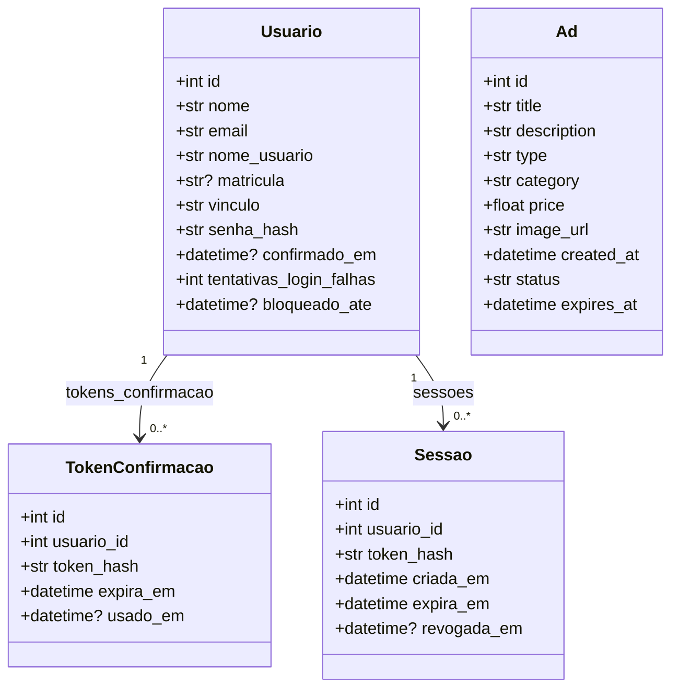

# Modelagem do banco de dados

O projeto usa SQLAlchemy sobre SQLite. Os modelos ORM ficam em
[models.py](models.py); a função `initialize_database` em
[database.py](database.py) cria as tabelas declaradas pelo metadata. O arquivo
[schema.sql](schema.sql) documenta o mesmo schema e deve permanecer sincronizado
com os modelos.

## Diagrama UML

`id` é a chave primária técnica, gerada pelo banco. `email` é o identificador
principal de negócio da conta (único e obrigatório); `nome_usuario` e
`matricula` são identificadores alternativos, também únicos. Nenhum deles é
usado como chave primária.

Manter uma chave substituta (`id`) evita que referências internas dependam de
identificadores institucionais ou dados de contato, que podem mudar ou exigir
maior cuidado de privacidade. A matrícula é opcional e única quando informada.

## Tabela `usuarios`

| Coluna | Tipo | Obrigatória | Restrições | Descrição |
|---|---|---:|---|---|
| `id` | INTEGER | Sim | Chave primária, autoincremento | Identificador interno do usuário |
| `nome` | TEXT | Sim | Não pode ser vazio ou conter somente espaços ASCII | Nome do usuário |
| `email` | TEXT | Sim | Único; não pode ser vazio ou conter somente espaços ASCII | E-mail institucional, identificador principal |
| `nome_usuario` | TEXT | Sim | Único; não vazio; não pode conter `@` | Identificador alternativo de login |
| `matricula` | TEXT | Não | Única quando preenchida (vários `NULL` são aceitos); não vazia se informada | Matrícula informada pela pessoa, sem conferência |
| `vinculo` | TEXT | Sim | `aluno` ou `funcionario` | Vínculo institucional |
| `senha_hash` | TEXT | Sim | Não vazio | Hash da senha (werkzeug); a senha nunca é gravada |
| `confirmado_em` | DATETIME | Não | — | Momento da confirmação do e-mail; `NULL` = pendente |
| `tentativas_login_falhas` | INTEGER | Sim | Padrão `0`; `>= 0` | Falhas de senha seguidas desde o último login ou bloqueio |
| `bloqueado_ate` | DATETIME | Não | — | Fim do bloqueio de login, se houver |

## Tabela `tokens_confirmacao`

| Coluna | Tipo | Obrigatória | Restrições | Descrição |
|---|---|---:|---|---|
| `id` | INTEGER | Sim | Chave primária, autoincremento | Identificador interno |
| `usuario_id` | INTEGER | Sim | FK → `usuarios.id`, `ON DELETE CASCADE`; indexada | Dono do link |
| `token_hash` | TEXT | Sim | Único | SHA-256 do token enviado por e-mail |
| `expira_em` | DATETIME | Sim | — | Fim da validade (15 minutos após a emissão) |
| `usado_em` | DATETIME | Não | — | Uso ou invalidação do link; `NULL` = ainda não usado |

## Tabela `sessoes`

| Coluna | Tipo | Obrigatória | Restrições | Descrição |
|---|---|---:|---|---|
| `id` | INTEGER | Sim | Chave primária, autoincremento | Identificador interno |
| `usuario_id` | INTEGER | Sim | FK → `usuarios.id`, `ON DELETE CASCADE`; indexada | Dono da sessão |
| `token_hash` | TEXT | Sim | Único | SHA-256 do token de sessão (`Authorization: Bearer`) |
| `criada_em` | DATETIME | Sim | — | Momento do login |
| `expira_em` | DATETIME | Sim | — | Fim da validade (`SESSAO_DURACAO_HORAS`) |
| `revogada_em` | DATETIME | Não | — | Logout; `NULL` = não revogada |

## Regras fora do banco

## Tabela `ads`

| Coluna | Tipo | Obrigatória | Restrições | Descrição |
|---|---|---:|---|---|
| `id` | INTEGER | Sim | Chave primária, autoincremento | Identificador interno do anúncio |
| `title` | TEXT | Sim | Não pode ser vazio ou conter somente espaços ASCII | Título do anúncio |
| `description` | TEXT | Não | — | Descrição opcional do anúncio |
| `type` | TEXT | Sim | `product` ou `service` | Tipo do anúncio |
| `category` | TEXT | Sim | Não pode ser vazia ou conter somente espaços ASCII | Categoria do anúncio |
| `price` | REAL | Sim | Valor numérico | Preço do anúncio |
| `image_url` | TEXT | Não | Pode ser nulo | URL da foto do anúncio |
| `created_at` | DATETIME | Sim | Data de criação | Momento de criação do anúncio |
| `status` | TEXT | Sim | `published`, `sold` ou `expired` | Estado de disponibilidade |
| `expires_at` | DATETIME | Não | Pode ser nulo | Momento de expiração, quando aplicável |

Os anúncios sem foto usam `image_url` nulo. O feed considera disponíveis apenas
os anúncios publicados; anúncios vendidos ou expirados não devem ser retornados.
O banco não calcula a expiração automática: essa regra pertence ao domínio e ao
caso de uso de publicação.

O banco garante as constraints estruturais acima, mas não valida o formato ou
o domínio do e-mail. A entidade `Usuario` valida o endereço (apenas
`@aluno.puc-rio.br` e `@puc-rio.br`) e grava `email`, `nome_usuario` e
`matricula` normalizados (sem espaços nas pontas e em minúsculas). Por isso
os `UNIQUE` simples bastam para a unicidade sem diferenciar maiúsculas de
minúsculas.

A regra de que nenhum valor pode ser, ao mesmo tempo, o nome de usuário de
uma conta e a matrícula de outra é conferida pelo caso de uso
`CadastrarUsuario`: o SQLite não oferece constraint entre colunas diferentes.

Datas são gravadas em UTC, sem fuso, e lidas de volta como `datetime` com fuso
UTC pelo tipo `UTCDateTime` de `models.py`.

O SQLite só aplica chaves estrangeiras e `ON DELETE CASCADE` com
`PRAGMA foreign_keys=ON`; `create_database_engine` ativa esse pragma em cada
conexão.

## Banco local e migração

O banco padrão fica em `server/database/db.sqlite3`; testes devem usar um banco
SQLite em memória. `create_all` cria tabelas ausentes, mas não atualiza tabelas
existentes.

A feature 001 (cadastro, login e verificação de e-mail) mudou a tabela
`usuarios` de forma incompatível. Por decisão do time (2026-11-20), não há
script de migração, pois só existem bancos locais de desenvolvimento: **apague
`server/database/db.sqlite3`** depois de atualizar o código, e ele será
recriado na próxima inicialização.

## Evolução do modelo

Ao adicionar, alterar ou remover dados persistidos, atualize em conjunto:

1. `schema.sql` e a inicialização/migração necessária;
2. este documento e o diagrama;
3. testes de constraints e comportamento de persistência;
4. o README principal, caso o local ou fluxo documentado do banco mude.

Antes de remover ou tornar obrigatório um campo, avalie os dados já existentes
e defina como serão migrados. Não descarte nem transforme dados existentes sem
uma regra aprovada.
