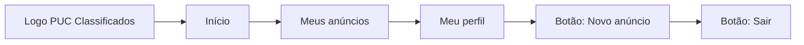
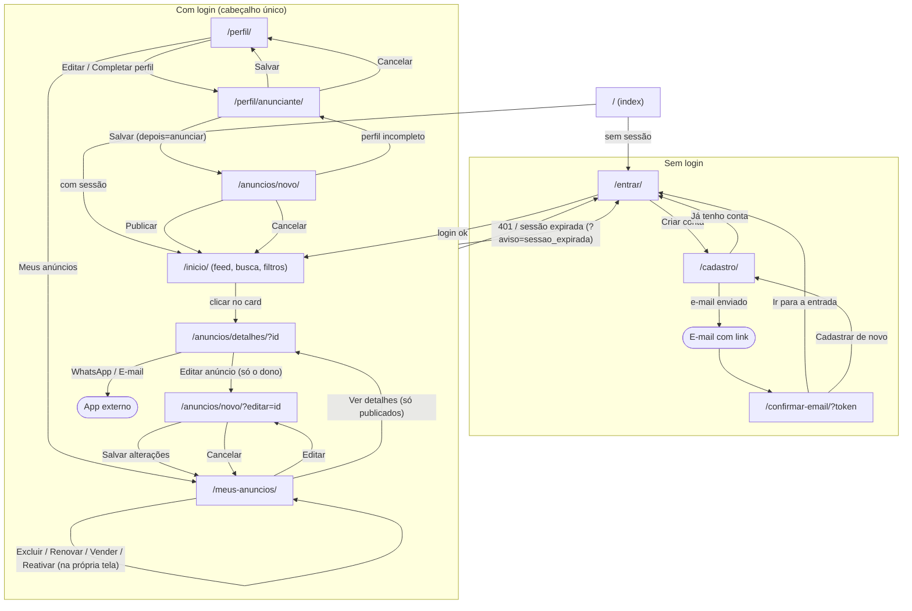

# Fluxo de navegação proposto

Proposta para alinhar telas, botões e links. Edite à vontade: renderiza no
GitHub, no VS Code (extensão Mermaid) e em https://mermaid.live.

## 1. Cabeçalho único (todas as telas autenticadas)

Mesmos itens, na mesma ordem, em todas as telas. A página atual recebe
`aria-current="page"`.

- Logo e "Início" levam a `/inicio/`.
- "Novo anúncio" é sempre botão primário (some o item de menu "Anunciar").
- Só `/inicio/` tem, além disso, busca e "Filtros".

## 2. Fluxo entre telas

Os caminhos "Ver detalhes" e "Editar anúncio" são novos (spec 013).

## 3. Decisões tomadas

Formalizadas na [spec 013](features/013-padronizar-navegacao-e-acoes/spec.md).

- [x] "Meus anúncios" no cabeçalho de todas as telas.
- [x] Sempre o botão azul "Novo anúncio"; sai o item "Anunciar".
- [x] "Cancelar" ao editar volta para Meus anúncios.
- [x] Dono do anúncio vê "Editar anúncio" nos detalhes (exige `is_owner` na API).
- [x] Cards de Meus anúncios ganham o botão "Ver detalhes" (não o título/imagem).
- [x] Padronizar rotas via `ROTAS` e imagens via `resolverUrlRecurso`.
